# StreetBite V1.0

StreetBite is a bilingual (English and Arabic) Flutter app for finding street food. You can browse meals from TheMealDB, look at vendors on a map, save favourites, put meals in a cart and place orders, all backed by Firebase. I built it solo as my graduation project.

## Links

- Repository: https://github.com/Shahd-zain1/streetbite-capstone
- Flutter app source: https://github.com/Shahd-zain1/streetbite-capstone/tree/main/flutter_app

## Screenshots

| Splash | Login | Sign up |
| --- | --- | --- |
| 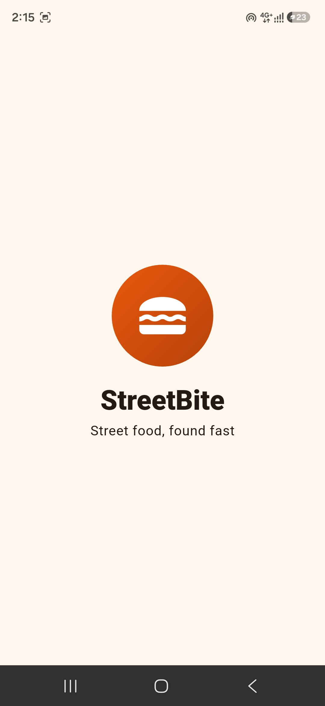 | 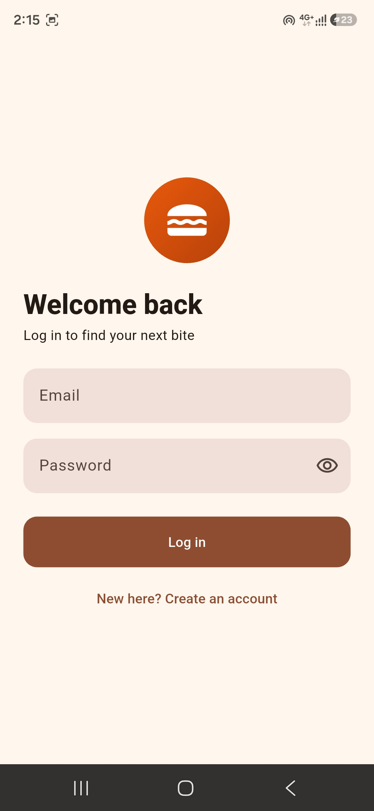 | 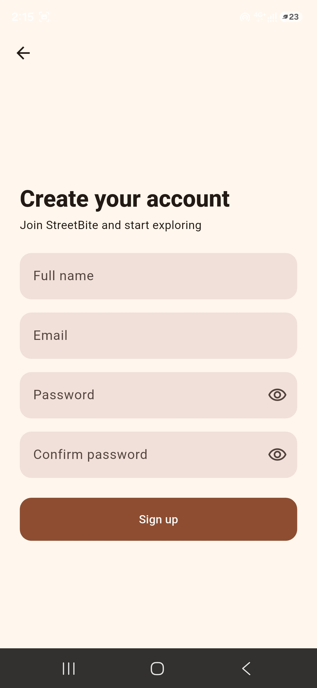 |

| Home (English) | Home (Arabic) | Meal details |
| --- | --- | --- |
| 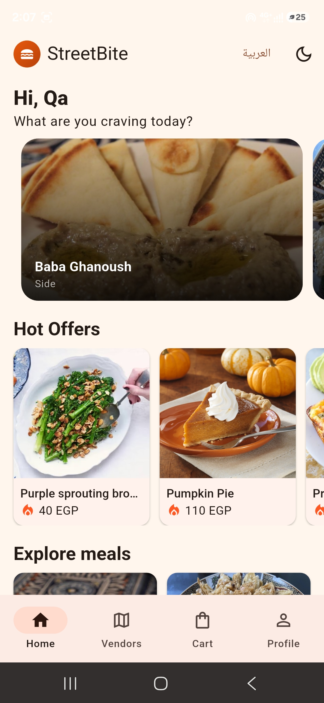 | 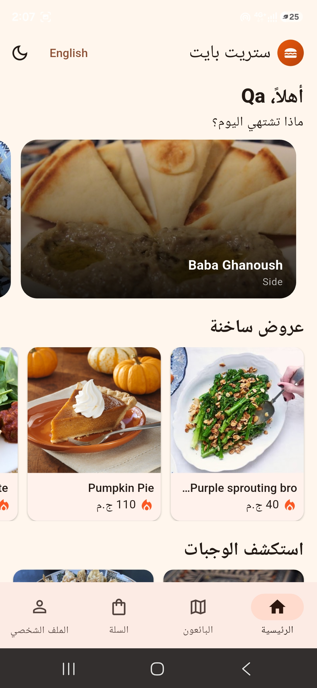 | 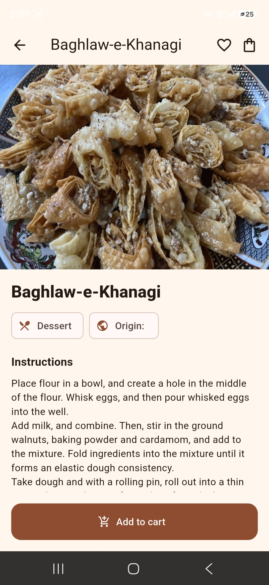 |

| Cart | Vendor map | Profile |
| --- | --- | --- |
| 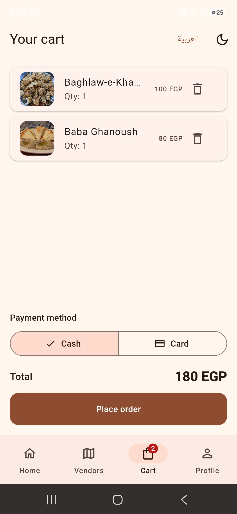 | 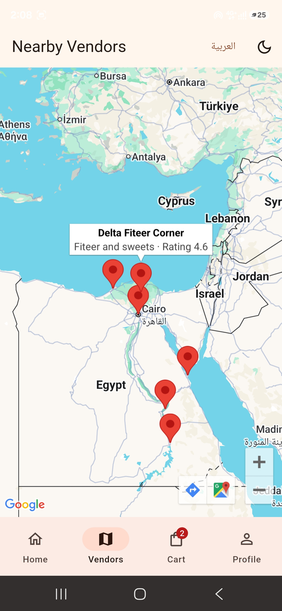 | 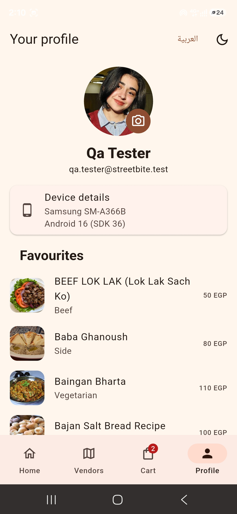 |

| Fingerprint prompt | Dark mode |
| --- | --- |
| 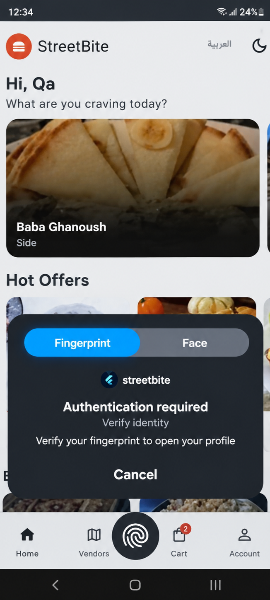 | 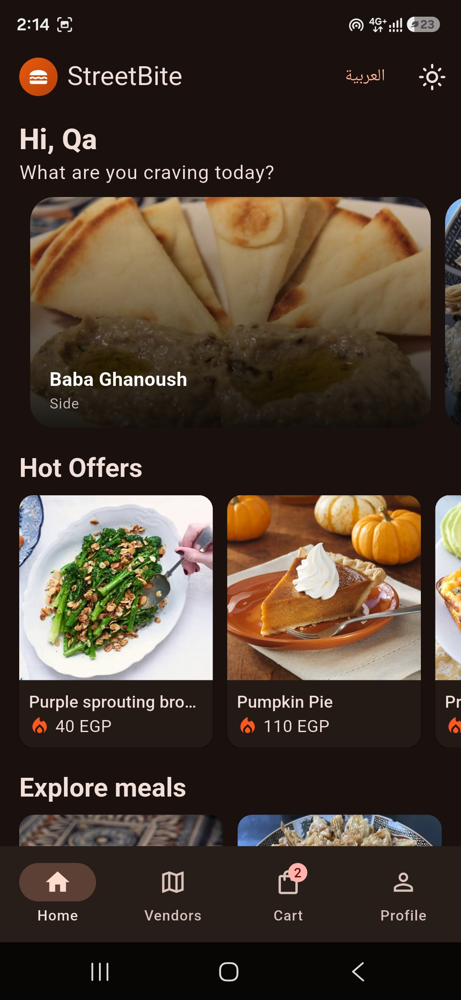 |

## What it does

Sign up and login use Firebase Authentication and the session survives app restarts. Home has a swipeable banner of featured meals, a Hot Offers row with five items and a two-column grid of everything else. Meals come from TheMealDB through Dio and are cached with shared_preferences, so the list still opens offline. The cart is driven by a CartBloc and orders are saved to Firestore. The profile screen shows your photo, device details, favourites and order history live from Firestore, and it only opens after a fingerprint check. The vendor map has six sample vendors in different Egyptian cities, each with a name, cuisine and rating in its info window.

Language (with right to left layout) and theme (light or dark) can be switched at runtime from the app bar, and both choices are remembered.

## Architecture

The code is split into three layers under `lib/`.

- `domain/` holds entities, repository interfaces, use cases and the payment classes. It has no Flutter or Firebase imports.
- `data/` holds the models (with `fromJson` and `toJson`), the data sources and the repository implementations.
- `presentation/` holds the Blocs and Cubits, the screens and the reusable widgets, one class per file.

`core/` has the shared pieces: theme, error mapping, validators and small services for biometrics, device info and image picking. Dependencies are wired in `injection.dart` with GetIt.

### Design patterns

- **Builder:** `data/models/user_builder.dart` assembles `UserModel`, used for both Firebase users and Firestore documents.
- **Factory:** `data/datasources/meal_data_source_factory.dart` picks the remote or the cached source, and `MealRepositoryImpl` asks it on every call.
- **Singleton:** `data/datasources/firestore_service.dart` is the single entry point to Firestore.
- **SOLID payments:** `PaymentProcessor` is the common interface, with `CashPayment` and `CardPayment` implementing it. `PlaceOrderUseCase` only knows the interface.

## Beta distribution

The release APK (`flutter build apk --release`) was uploaded to Firebase App Distribution as release 1.0.0 (1) and sent to the `beta-testers` group, which has two testers.

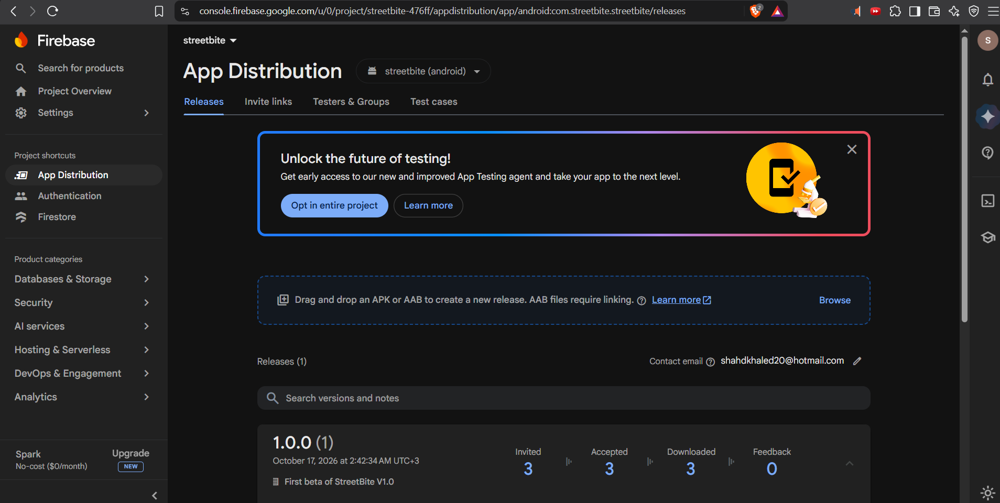

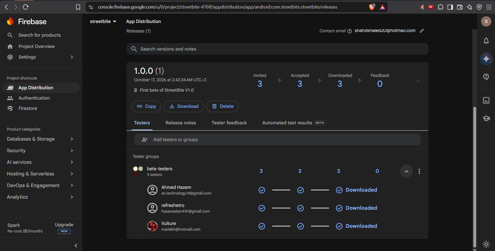

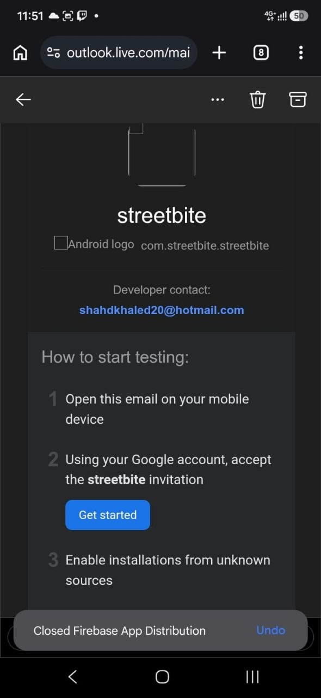

## Testing

**Manual QA.** The test plan, 41 test cases for Login and Home (GUI, positive, negative and general mobile), the traceability matrix and the closure summary are in the [`qa`](../qa) folder, together with the Jira evidence. On a Samsung SM-A366B, 39 cases passed, 1 failed and 1 was blocked, which is a 95.1% pass rate. The failure is logged in Jira as SB-1.

**Automation.** The Appium and Java suite is in [`appium_tests`](../appium_tests). It covers valid login, invalid credentials, empty fields, scrolling the meals grid and adding a meal to the cart with a SnackBar check. A shared `BaseTest` sets up the driver and saves a screenshot after every test, and the suite was run on an Android emulator and on the physical phone.

## Known issues and limits

- **SB-1:** when the phone is offline, cached meals appear without their photos, because images are not cached. It is open and documented rather than fixed.
- Card payment is simulated with a short delay. There is no real payment gateway.
- TheMealDB has no prices, so each meal gets a fixed price derived from its id (40 to 130 EGP).
- The six map vendors are hardcoded sample data.
- The full name check requires a capital first letter. Arabic has no letter case, so Arabic names pass.
- Profile photos are resized and compressed when picked and stored as base64 in the user document, because Firebase Storage is not used.

## Running the project

The Firebase configuration for my project (`lib/firebase_options.dart` and `android/app/google-services.json`) is included, so the app runs against it as it is. You need Flutter 3.35.6.

1. In `flutter_app`, run `flutter pub get`.
2. Connect an Android device or start an emulator, then run `flutter run`.

To use your own backend instead, run `flutterfire configure` and choose your project, enable Email/Password sign in, create a Firestore database and paste `firestore.rules` into its Rules tab. The Google Maps key in `AndroidManifest.xml` is mine, so replace it with your own if the map stays empty.

The Android folder is already configured as described below. `setup.ps1` is only needed to rebuild it from scratch: run `./setup.ps1 -MapsKey <your key>` in PowerShell, then `flutterfire configure`.

### Permissions and Android configuration

- `INTERNET` for the API, Firebase and maps.
- `USE_BIOMETRIC` for the fingerprint check before the profile opens.
- `MainActivity` extends `FlutterFragmentActivity` (required by local_auth) and `minSdk` is 23.
- The Google Maps key goes in `AndroidManifest.xml` as `com.google.android.geo.API_KEY`.
- Kotlin plugin 2.3.10 with a `JvmTarget.JVM_11` compiler option, which fixes the google_maps_flutter build errors.
- Gallery access uses the Android photo picker, so no storage permission is needed.

## Repository layout

- `flutter_app/` the Flutter app, with screenshots and the presentation in `docs/`.
- `appium_tests/` the Appium and Java automation project.
- `qa/` the manual QA package: test plan, test cases, traceability, closure summary and Jira evidence.

The presentation is in [`docs/presentation`](docs/presentation).
